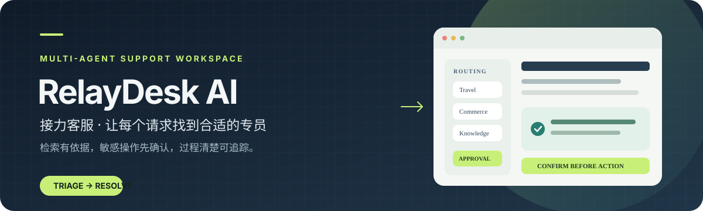
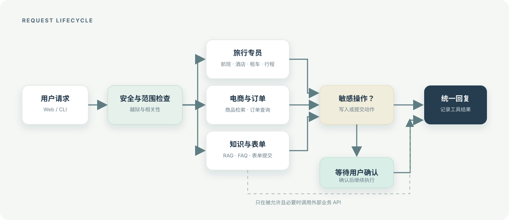

<div align="center">

# RelayDesk AI

**接力客服 · 面向旅行与电商场景的多智能体客服工作台**

先判断请求，再交给合适的专员；需要写入数据时，先让用户确认。

[能力](#能力) · [架构](#工作流) · [运行](#快速运行) · [配置](#配置) · [隐私与安全](#隐私与安全)

</div>



RelayDesk AI 使用 LangGraph 编排多个专用客服助手，为旅行服务和电商支持处理查询、知识检索与需要确认的操作。每个助手只处理自己的业务范围；主助手负责分流、上下文衔接和统一回复。

## 能力

| 区域 | 处理内容 |
| --- | --- |
| 旅行服务 | 航班、酒店、租车、行程查询与预订变更 |
| 商城支持 | WooCommerce 商品和订单查询 |
| 知识检索 | FAQ 文档解析、向量化与基于检索结果的回答 |
| 表单与文章 | 表单提交、博客文章搜索 |
| 安全与审批 | 输入范围检查；旅行变更等敏感操作暂停并等待确认 |
| 多种入口 | FastAPI 网页聊天与命令行交互 |

## 工作流

请求先经过安全与范围检查，再进入旅行、电商或知识专员。知识查询会使用 FAQ 向量库；标记为敏感的操作会暂停，等待用户确认后继续。



## 快速运行

需要 Python 3.12、Poetry、Docker Compose，以及可用的 OpenAI 兼容 API。网页和 FAQ 检索还需要 Qdrant。

```sh
poetry install
cp .env.example .env
```

在 `.env` 中至少配置 `OPENAI_API_KEY`。启动 Qdrant 和网页服务：

```sh
docker compose up --build
```

打开 `http://localhost:8000`。也可以只启动向量数据库，再从本机运行应用：

```sh
docker compose up -d qdrant
poetry run uvicorn web_app.app.main:app --reload --host 127.0.0.1 --port 8000
```

将 FAQ 文档放入 `faq_documents/`，再运行向量化任务：

```sh
poetry run python -m vectorizer.app.main
```

如需航班、酒店、租车和行程工具，另行配置 `SQLITE_DB_PATH` 指向你有权使用的兼容数据库，并设置 `DEMO_PASSENGER_ID`。数据库快照不随仓库分发。

也可以创建仓库自带的虚构演示数据库：

```sh
poetry run python setup_database.py
```

Compose 方式运行时使用 `docker compose exec relaydesk python setup_database.py`。脚本只会创建新的 `data/travel2.sqlite`；如果该文件已存在会拒绝覆盖。演示旅客 ID 为 `DEMO-001`。

## 配置

配置项示例见 [.env.example](.env.example)。WooCommerce、表单和博客搜索是可选集成；只有配置对应地址和凭据时才会启用。GoHumanLoop 未配置时在本地命令行回退到终端审批；网页场景如需管理员审批，应配置远程 API 地址和密钥。`.env` 不要提交到 Git。

## 隐私与安全

- 会话 JSON、数据库、日志、缓存和上传数据已从交付目录排除，并加入 `.gitignore`。
- 网页会话使用随机 UUID；Cookie 默认启用 `HttpOnly` 与 `SameSite=Lax`。通过 HTTPS 部署时设置 `SESSION_COOKIE_SECURE=true`。
- 网页提供“新建对话”，会清除当前会话记录并轮换会话 ID。
- 动态聊天内容按纯文本插入页面，避免将消息内容作为 HTML 执行。
- WooCommerce 请求启用标准 TLS 证书校验；日志不记录查询邮箱或原始提问。
- 输入护栏只放行通过安全和业务范围检查的请求。护栏是辅助机制，不构成生产环境安全保证。

这是集成示例，默认面向本机开发。正式使用前应评审身份认证、管理员权限、数据保留、API 限流、错误恢复和人工审批链路。

## 项目结构

```text
relaydesk/       LangGraph 状态图、客服专员、业务工具与对话服务
web_app/         FastAPI 网页入口、会话管理与聊天界面
vectorizer/      FAQ 与业务数据向量化
faq_extension/   FAQ 文件发现、解析与更新
faq_documents/   可自行放入的知识库文档
docs/            架构与来源说明
assets/          项目横幅与流程图
```

## 来源与许可

本项目是在权利方另行授权下整理的改编项目；原来源的 Git 提交历史和个人邮箱没有带入。此次授权不等同于为后续使用者授予通用开源许可；目前仓库未声明通用开源许可证。来源说明见 [docs/ORIGIN.md](docs/ORIGIN.md)。
